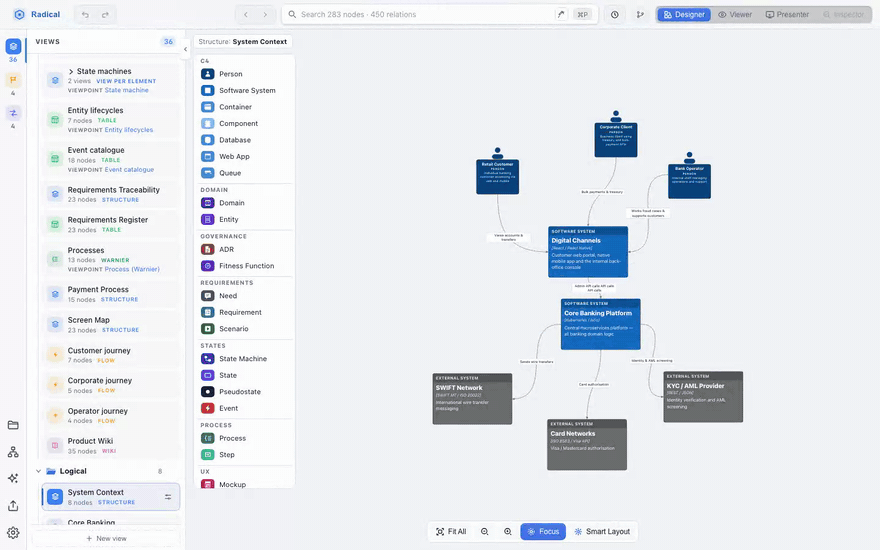
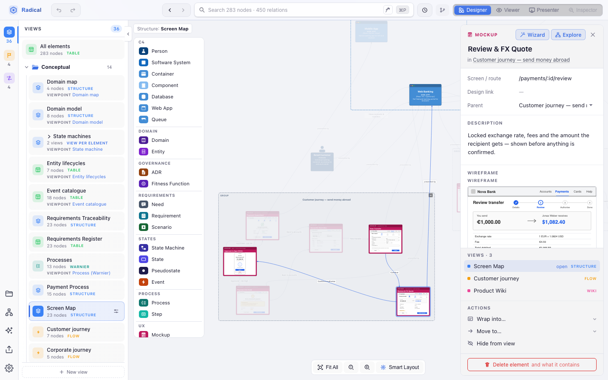
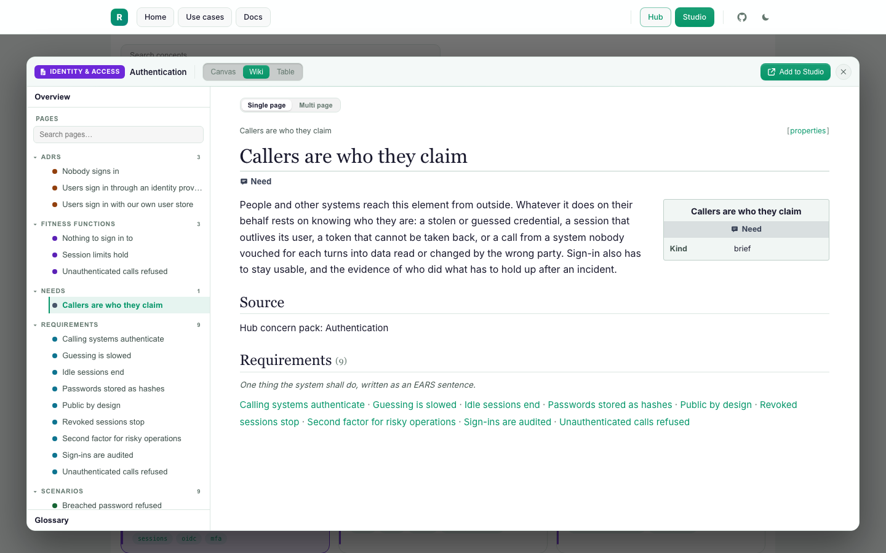
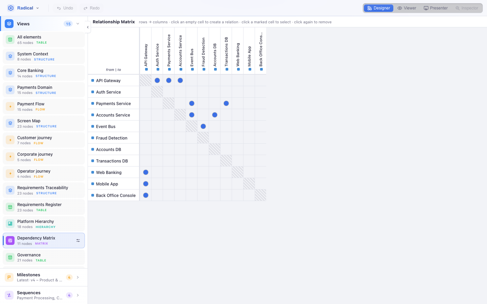
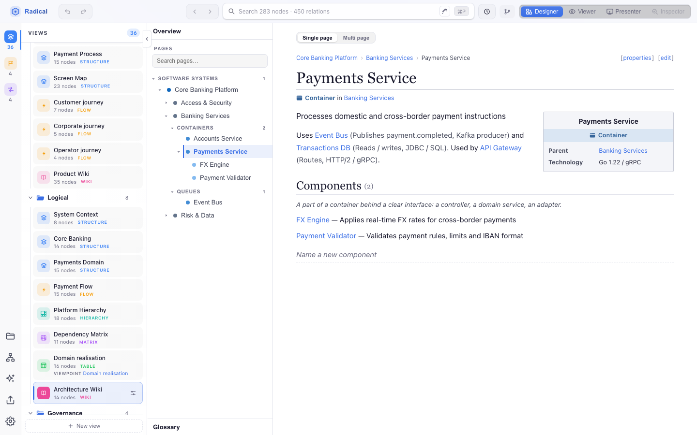

<div align="center">

# radical.tools

**Open-source architecture studio: one living model of your system, for your team and your coding agents.**

C4, decisions, requirements and fitness functions in one model. Free and MIT licensed, in the browser, no account.

[](https://github.com/radicaltools/radical.tools/actions/workflows/ci.yml)
[](LICENSE)
[](https://studio.radical.tools)

[**Try it in the browser**](https://studio.radical.tools) · [Architecture Hub](https://hub.radical.tools) · [Use cases](https://radical.tools/usecases.html) · [Guide](https://radical.tools/manual.html) · [Reference](https://radical.tools/reference.html)



</div>

## Try it

**[Open studio.radical.tools](https://studio.radical.tools)**: no sign-up, nothing to install. Start from the sample model or your own; the model stays in your browser or in files you choose.

**Connect your coding agent:** `npx @radicaltools/cli setup` connects Claude Code, Claude Desktop, Codex, Cursor or VS Code to a model folder, step by step, and `radical setup --status` checks the connection ([CLI usage](apps/cli/README.md#radical-setup)). No Node.js yet? In an empty folder, `curl -fsSLO https://radical.tools/radical.sh && sh radical.sh setup` (or `radical.cmd` on Windows) downloads it first. Then ask your agent to model the repository it works in, and open the same folder in Studio (*Models → Open folder…*) to see the model.

**Desktop app and VS Code:** installers for macOS, Windows and Linux are on the [latest release](https://github.com/radicaltools/radical.tools/releases/latest); to build them yourself, see [Getting started](#getting-started). An extension that opens `.radical` files right in VS Code lives in [apps/vscode](apps/vscode).

## Why radical.tools?

Architecture diagrams go stale because they are pictures. In radical.tools they are **views of one model**. Every element lives once, and the structure and flow canvases, hierarchy, dependency matrix, table and wiki all read from it. The decisions, requirements and fitness functions that explain the architecture live in the same model, linked to the elements they govern.

- **No account, nothing to install.** Open it in the browser and start modelling. Your model stays in local storage or plain files you can commit.
- **C4 without the busywork.** Smart Layout places nodes, minimises crossings and fits groups for you, and keeps the rows, columns and grids you pin.
- **From a paragraph to a model.** Radical Forge turns a system description into requirements, a domain model, fitness functions, Gherkin scenarios, state machines, processes, UI mockups and a C4 model, one reviewable stage at a time, each filling the gaps it finds in the ones before, and ends with a review of the whole model.
- **Your coding agents follow it.** The MCP server lets Claude Code, Codex or Cursor read and edit the model, and `radical check` in CI says where the code and the model part ways.
- **Bring your own AI.** OpenAI, Anthropic, Gemini, or a local model through Ollama.
- **Decisions you would forget, asked for.** The [Hub](https://hub.radical.tools)'s concern packs, in nine groups from Architecture to Technology, each ask a few questions and bring the requirements, the decision, runnable fitness functions and scenarios that fit your answers; `radical check` and the Inspector point out the concerns your model has not decided yet.

<table>
  <tr>
    <td width="50%"><br><sub><b>UI mockups & screen flows</b>, AI-generated wireframes linked to requirements</sub></td>
    <td width="50%"><br><sub><b>Concern Hub</b>, packs that settle a concern in a few answers</sub></td>
  </tr>
  <tr>
    <td width="50%"><br><sub><b>Dependency matrix</b>, one of six views over the same model</sub></td>
    <td width="50%"><br><sub><b>Architecture wiki</b>, documentation generated from the model</sub></td>
  </tr>
</table>

## Features

- **C4 model**: Person, Software System, Container, Component, Database, Web App, Queue, Group, joined by *Interacts*
- **Domain & Governance elements**: Domain, Entity (aggregate root or entity, with *part of* and *references* between entities), ADR, Fitness Function, Need (raw free-text input such as a brief or notes), Requirement (EARS, derived from needs), Scenario (Gherkin, verifies requirements, names the tests that run it), Blueprint
- **State machines**: event-driven hierarchical statecharts (SCXML semantics) — State Machine, State (compound, parallel regions, final), Pseudostate (initial, history, choice) and Event, linked by transitions that point at their trigger and the events they raise; each machine is the lifecycle of a domain Entity and is implemented by C4 elements; Studio checks that each machine can run (initial states, reachability, unguarded conflicts)
- **UI mockups**: Mockup element with a design link or an AI-generated low-fi wireframe, linked to requirements and scenarios (*illustrates*), to the container that renders it (*presented by*) and to other screens (*navigates to*) to model screen flows
- **Smart Layout**: tidies the canvas as a person would, one move at a time from what is there (stores beside their users, actors on top, queues between their sides, lines straightened, rows ordered and evenly spaced, the rest drawn in), judging each move on how the diagram reads as drawn; it knows the notation through layout hints in the metamodel (roles per element type, a reading direction per relation type), unpins what it rearranges (*Tidy around* a selection keeps the rest, pins included), keeps a view tidy after every change when *Keep smart* is on (elements glide into place, the view saves the setting), and lists its moves and the reader's cost part by part in *Why this layout?*; an Ensemble mode per view runs eleven algorithms ranked instead; curved or orthogonal lines per view
- **Alignments**: keep elements in a row, a column or a grid per view, optionally in the order you selected them (or a container's children with *Align children…*); drags, live physics and Smart Layout hold them, and the AI tools and MCP server can set them
- **Calm drags**: a drag moves only what you drag and pushes clear only what you drop it on; dropped elements stay pinned where you put them (⌘/Ctrl-drag lets the live physics make room instead)
- **Multiple layout engines**: ELK (hierarchical/layered/force), webcola (live physics), custom Smart Layout pipeline
- **AI assistant**: chat with OpenAI / Anthropic / Gemini / Ollama to generate and modify diagrams
- **Radical Forge**: turn a system description into requirements, a domain model, fitness functions, Gherkin scenarios, state machines, processes, UI mockups and a C4 model, one reviewable stage at a time, each filling gaps in the ones before (you keep or reject each such change), and a final review; the description is kept in the model as a Need the requirements derive from
- **Concern Hub**: concern packs in nine groups (Architecture, Identity & access, Security, Data, Integration, Reliability, Operations, Maintainability, Technology) on [hub.radical.tools](https://hub.radical.tools); a wizard asks a pack's questions and binds the requirements, decision, fitness functions (each with its tool and a snippet) and scenarios to the elements they are about; `radical check` reports undecided concerns (`concern-unaddressed`) and unbound decisions (`concern-unbound`); Radical Forge asks them early and binds them in its C4 stage
- **Eight view kinds**: Structure, Flow, Hierarchy, Table, Matrix, Wiki, Warnier and Explore, each filtered by a chain of levels (needs → requirements → scenarios) or, for Explore, grown level by level from one element, and kept in folders
- **Presentation mode**: slides over views and milestones, played in the window with a navigation bar
- **Metamodel editor**: customise node types, relation types, and constraints, with typed properties including references to other elements
- **Time travel**: milestones of the whole model, with a diff against the previous one and edits that propagate to later milestones
- **Inspector**: what `radical check` says about the model — its quality on its own (consistency, completeness, traceability, decisions), how faithfully the implementation follows it by the tests, and its `check.json` goals and rules as settings — with links to each element
- **radical check**: a CLI that checks a model folder's metamodel rules, completeness and the tests it names; CI runs it on this repository's own model ([architecture/](architecture))
- **radical fuzz** (Radical Crucible): runs a project's fuzz files, random sequences of actions with the system's rules checked after every step, by plan; a survey records each new way a rule breaks as a finding to fix or decide, and every rule of a fuzz file is a test case the model can name ([CLI usage](apps/cli/README.md#radical-fuzz), [docs/CRUCIBLE.md](docs/CRUCIBLE.md)); **radical harden** turns a finding into a test (a fuzz finding replays its own steps) and gates a test: it must fail without the fix, pass with it, and pass several runs at once; **radical explore** prepares an exploratory round of agents (one build, a folder, ports and an area per run, a brief of what changed in the code and the model), re-runs their scripts and records their findings
- **Confluence publication**: export a selected wiki view as Markdown or HTML, or publish a managed Confluence Cloud page tree with requirements, scenarios and links; Radical stays the source of truth ([CLI usage](apps/cli/README.md#radical-export-confluence))
- **MCP server**: [@radicaltools/mcp](apps/mcp) lets Claude Code, Claude Desktop or Codex read and edit a Markdown model folder, with the same tools as the AI assistant
- **radical setup** and **radical setup --status**: connect your agents to a model folder in one guided command (a new model in an empty folder, an MCP server entry in each agent's configuration, pinned to the CLI's version, the git hooks), and check every link from Node to a server that answers for the folder
- **Models**: kept in the browser, in one `.radical` file or in a folder of Markdown files (git-friendly); Structurizr DSL import
- **Export**: PNG/SVG export and copy to clipboard of any view

## Tech stack

| Layer | Technology |
|---|---|
| Shell | Electron 29 |
| Bundler | electron-vite + Vite 5 |
| UI | React 18 + ReactFlow 11 |
| State | Zustand + Immer |
| Layout | ELK.js, webcola, custom SA pipeline |
| Language | TypeScript 5 |

## Getting started

**Prerequisites:** Node.js ≥ 20.11 (CI uses 24), npm ≥ 9

```bash
# Install dependencies
npm install

# Once after cloning: git hooks that keep architecture/.radical/base.json, the
# base Studio's "Changes on branch" compares with, after every checkout,
# commit, pull and rebase (radical hooks install)
npm run hooks

# Start in development mode (Electron, hot-reload)
npm run dev

# Type-check
npm run typecheck

# Run tests
npm test

# Production build (outputs to apps/studio/out/)
npm run build

# Run built Electron app
npm start

# Desktop installers for the current OS (outputs to apps/studio/dist/)
npm run dist

# Browser build of Studio: dev server / production build (studio.radical.tools)
npm run dev:web
npm run build:web

# Architecture Hub (hub.radical.tools): dev server / production build
npm run dev:hub
npm run build:hub

# Check this repository's own architecture model, as CI does
npm run test:reports
npm run check:architecture
```

### Releasing (maintainers)

radical.tools has one product version: the CLI, the MCP server, the Desktop app and the VS Code extension always carry the same one (see the ADR *Product and format versioning* in `architecture/`). Write each user-visible change under `## [Unreleased]` in [CHANGELOG.md](CHANGELOG.md) as you make it; a release moves those entries under its version.

```bash
npm run release -- minor          # or major, patch, or a version such as 0.3.0 or 1.0.0-rc.1
```

On `main` it switches to a branch `release/v<version>`, sets the version in the four `package.json` files and the lockfile, cuts the changelog and commits. Push the branch and open a pull request; merging it is the release decision. Then, on an up-to-date `main`:

```bash
npm run release:tag               # tags the merge commit v<version>
git push origin v<version>
```

The tag releases everything at once:

- [Release Desktop App](.github/workflows/release.yml) builds the macOS, Windows and Linux installers and drafts a GitHub Release with the version's changelog section; review it, then publish.
- [Publish VS Code Extension](.github/workflows/vscode-publish.yml) publishes the extension to the Marketplace (not for a pre-release, which the Marketplace does not take).
- [Publish to npm](.github/workflows/npm-publish.yml) verifies and publishes `@radicaltools/cli` and `@radicaltools/mcp`, on the dist-tag `next` for a pre-release. It refuses a tag whose commit is not on `main` and skips a version npm already has, so re-running it after a failure publishes what is left.

Each first checks that all four packages carry the tag's version and the changelog has its section. Since pushing a `v*` tag publishes, keep tag creation to maintainers (a tag ruleset in the repository settings).

Every build carries its version, commit and build day: `radical --version`, `radical-mcp --version` and Studio's *About Radical Studio* show them, a build that is not the tagged release as `<version>+<commit>`.

## Project structure

The repo is an npm workspaces monorepo. Run every command from the root; it
forwards to the right workspace.

```
apps/
  studio/         Radical Studio: Electron app + web SPA (studio.radical.tools)
    src/main/       Electron main process (IPC handlers, file dialogs)
    src/preload/    contextBridge API surface exposed to renderer
    src/renderer/src/
      components/   Studio's own UI (Toolbar, Matrix / Sequence / Treemap views,
                    Forge, document manager, modals, …)
      store/        documentStore (localStorage, files, markdown folders)
      persistence/  Autosave: keeps the diagram store and the active document in sync
      ai/           AI chat, providers (OpenAI, Anthropic, Gemini, Ollama), Forge
      platform/     host(): which host Studio runs in (see @radical/host-bridge)
      hub/          Importing Hub concepts into a model
    tests/          Vitest unit/integration tests
    tools/          Sample model generator
    build/          Desktop app icon used by electron-builder
  hub/            Architecture Hub (hub.radical.tools): read-only viewer,
                  built on @radical/ui
  vscode/         VS Code extension; bundles the Studio web build as its webview
  e2e/            End-to-end regression suite (Playwright) for the web builds
                  of Studio and Hub, with screenshot baselines
  mcp/            @radicaltools/mcp: local stdio MCP server for model folders
  cli/            @radicaltools/cli: check, diff, hooks and Confluence wiki export
                  (metamodel, completeness, the tests it names)
  web/            Marketing site, guide and reference (radical.tools)
packages/
  common/         @radical/common: C4 + metamodel types, file formats, query
                  language, AI tool catalogue. No UI dependencies
  layout/         @radical/layout: Smart Layout and the headless layout engines,
                  with their tests, benchmark and visual harness
  ui/             @radical/ui: the canvas, panels, Wiki / Table views and the
                  diagram store, shared by Studio and the Hub. Documents and AI
                  plug in from the app (store/documentBackend,
                  components/wireframeGeneration)
  host-bridge/    @radical/host-bridge: typed contract between Studio and its
                  host (Electron, VS Code webview, browser)
  hub-catalogue/  @radical/hub-catalogue: the Hub's concern packs (specs in
                  packs/<group>/, built into catalogue/concern/ by
                  npm run build:packs), their validation and the Vite plugin
                  that serves and bundles them for the Hub and Studio
  node-files/     @radical/node-files: model folders on disk for Node (MCP, CLI)
architecture/     The architecture model of radical.tools itself, checked in CI
infra/            Terraform: AWS S3 + CloudFront + Route53 + IAM (OIDC)
tools/            Repo-wide scripts (check-workspaces.mjs, test-reports.mjs, generate-icons.mjs)
docs/             Architecture notes and improvement log
```

## Running tests

```bash
# All tests (vitest)
npm test

# Watch mode
npm run test:watch

# End-to-end regression suite (Playwright) against the web builds
npm run e2e

# One JSON report per workspace, for radical check
npm run test:reports

# The fuzz files of crucible.json, through radical fuzz (night: more runs, a random seed)
npm run fuzz
npm run fuzz -- night --survey

# The guide's screenshots (apps/web/screenshots), light and dark
npm run docs:screenshots
```

See [apps/e2e/README.md](apps/e2e/README.md) for the e2e suite, its
screenshot baselines and the guide's screenshots.

## Contributing

Contributions are welcome: code, docs, bug reports, and new concern packs for the [Hub](https://hub.radical.tools). Start with [CONTRIBUTING.md](CONTRIBUTING.md) and look for issues labelled [`good first issue`](https://github.com/radicaltools/radical.tools/labels/good%20first%20issue).

If radical.tools is useful to you, a ⭐ on GitHub helps others find it.

## License

[MIT](LICENSE)
